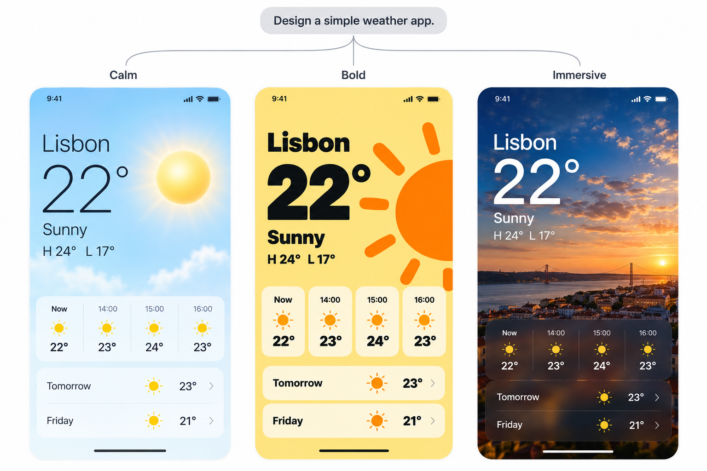

# 3VM

**See three ways your design could look.**

I made 3VM for when I know a screen could look better, but can't quite picture how. Give your AI a screenshot or an idea. It creates three visual mockups and helps you choose one.

**[Read the skill](SKILL.md)** · Free to use · Image generation required · Beta

*Illustrative mockups. [Example details](examples/weather-app.md).*

## Install in Codex

[Download the ZIP](https://github.com/xyloshin/3vm/releases/download/v0.1.0-beta.1/3vm-release.zip), unzip it, and put the `3vm` folder in `~/.codex/skills`, then use `$3vm` with your screenshot or idea. Your assistant needs a working image-generation tool.

What you get

Three separate images for the same screen, each with a short explanation of its benefit and tradeoff, followed by a recommendation. Small tweaks stay small; open briefs allow more variation. It uses your screenshot, brief, and conversation without requiring external design research.

Choose a direction, then ask your assistant to implement it when you're ready.

Setup and beta notes

3VM is a set of instructions for your current assistant. It does not add image generation to an app that lacks it. The skill is free; your assistant and image tools may have their own costs and limits. No reference-library subscription or second assistant is required.

For Codex, the file should end up at `~/.codex/skills/3vm/SKILL.md`. If you've configured `$CODEX_HOME`, use its `skills` folder instead. Already have a skill called `3vm`? Keep your copy and try this package in a separate environment.

Version 0.1.0-beta.1. The example is a maintainer-produced demonstration, not an independent behavioral test. Package checks do not establish model reliability, and native discovery in a clean assistant installation and cross-app behavior have not been tested. See [evaluation notes](EVALUATION.md).

Mockups can contain errors. They don't verify working interactions, accessibility, or responsive behavior. Share only screenshots you're comfortable providing to your chosen assistant and image service.

[MIT License](LICENSE) · Free to use and adapt.
