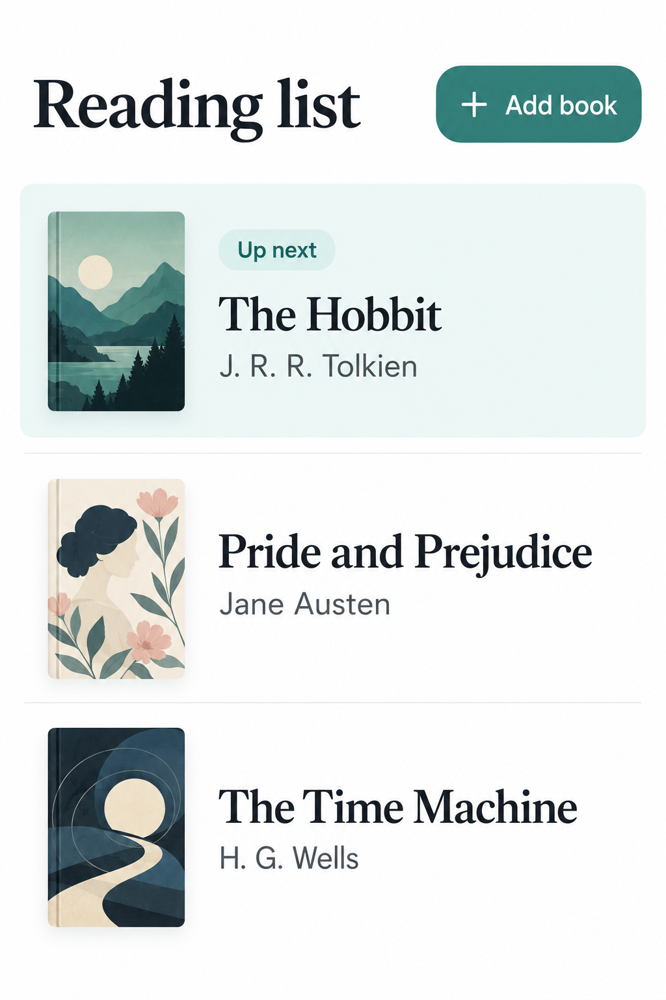
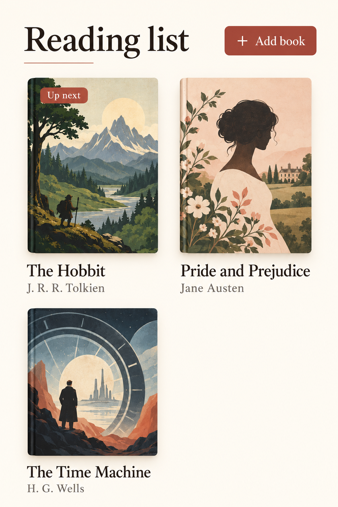
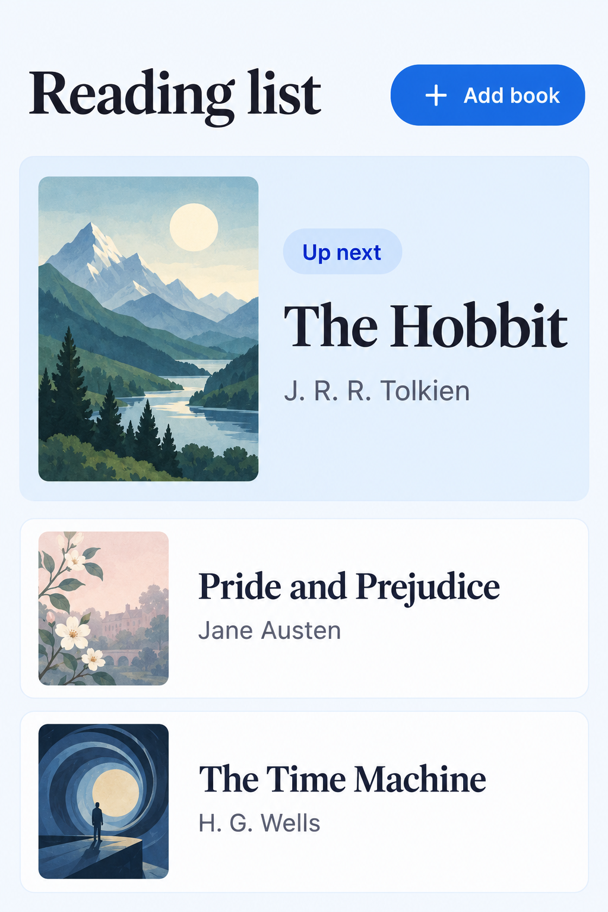

# One brief, three directions

This is a maintainer-produced demonstration using the built-in image-generation tool on 20 October 2026. The app and sample reading list are fictional. The maintainer supplied the brief and direction prompts below; this was not an independent installation or behavioral test of the packaged skill.

## Brief

```text
Design a simple mobile reading list. It has three saved books: The Hobbit by J. R. R. Tolkien, Pride and Prejudice by Jane Austen, and The Time Machine by H. G. Wells. Make The Hobbit the next read and make adding a book easy. Show three different ways to arrange the same content. No social feed, ratings, statistics, or extra features.
```

## 1. Compact list



Compact list makes all three books easy to scan, with less space devoted to cover artwork.

## 2. Visual shelf



Visual shelf gives the covers more presence, but takes more vertical space.

## 3. One book first



One book first makes the next read obvious, while the rest of the list gets less emphasis.

For this brief, **One book first** is the recommended direction because the next read is immediately visible and the add action remains easy to find. This is a design judgment, not a measured usability result.

<details>
<summary>Generation prompts</summary>

### Option 1

```text
Use case: ui-mockup. Create ONE high-fidelity mobile app screen image, portrait 2:3 aspect ratio. It is a standalone design concept for an imaginary reading-list app. Flat front-on UI fills the image, no physical phone frame, no angled device, no surrounding scene, no presentation title or option number. Keep safe internal padding. Required text: title 'Reading list', button '+ Add book', three books with exact titles and authors: 'The Hobbit' / 'J. R. R. Tolkien', 'Pride and Prejudice' / 'Jane Austen', 'The Time Machine' / 'H. G. Wells'. The Hobbit is labeled 'Up next'. No extra functionality, progress, stars, ratings, statistics, account icons, bottom navigation or invented data. All three titles and authors and the add button must be readable and fully visible. Small original abstract cover art is allowed, do not reproduce commercial covers. Polished, calm, professional interface. Direction: COMPACT LIST. White background, charcoal text, restrained teal accent. Header at top with small clear Add book button. Three elegant horizontal rows with small abstract book covers, titles and authors; first row subtly tinted with a small Up next badge. Fine separators, generous whitespace, strong typography. Optimize quick scanning and density without making it sparse.
```

### Option 2

```text
Use case: ui-mockup. Create ONE high-fidelity mobile app screen image, portrait 2:3 aspect ratio. It is a standalone design concept for an imaginary reading-list app. Flat front-on UI fills the image, no physical phone frame, no angled device, no surrounding scene, no presentation title or option number. Keep safe internal padding. Required text: title 'Reading list', button '+ Add book', three books with exact titles and authors: 'The Hobbit' / 'J. R. R. Tolkien', 'Pride and Prejudice' / 'Jane Austen', 'The Time Machine' / 'H. G. Wells'. The Hobbit is labeled 'Up next'. No extra functionality, progress, stars, ratings, statistics, account icons, bottom navigation or invented data. All three titles and authors and the add button must be readable and fully visible. Small original abstract cover art is allowed, do not reproduce commercial covers. Polished, calm, professional interface. Direction: VISUAL SHELF. Warm ivory background, dark ink serif heading, restrained brick accent, editorial bookstore feel. Header and Add book action above a two-column book-cover grid; first two books in first row, third in next row. All names beneath covers. Up next is a tasteful small label on The Hobbit card. Optimize browsing visually, keep content uncluttered. Two-column arrangement is the defining layout.
```

### Option 3

```text
Use case: ui-mockup. Create ONE high-fidelity mobile app screen image, portrait 2:3 aspect ratio. It is a standalone design concept for an imaginary reading-list app. Flat front-on UI fills the image, no physical phone frame, no angled device, no surrounding scene, no presentation title or option number. Keep safe internal padding. Required text: title 'Reading list', button '+ Add book', three books with exact titles and authors: 'The Hobbit' / 'J. R. R. Tolkien', 'Pride and Prejudice' / 'Jane Austen', 'The Time Machine' / 'H. G. Wells'. The Hobbit is labeled 'Up next'. No extra functionality, progress, stars, ratings, statistics, account icons, bottom navigation or invented data. All three titles and authors and the add button must be readable and fully visible. Small original abstract cover art is allowed, do not reproduce commercial covers. Polished, calm, professional interface. Direction: ONE BOOK FIRST. Very pale cool background, charcoal type, cobalt blue accent. Header and Add book action above a prominent full-width card highlighting The Hobbit with Up next, title, author, medium original abstract cover. Beneath, two compact horizontal rows for Pride and Prejudice and The Time Machine. Make the next choice immediately obvious. No start/continue buttons, progress stats or invented labels.
```

</details>
